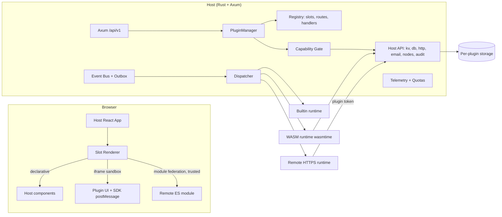
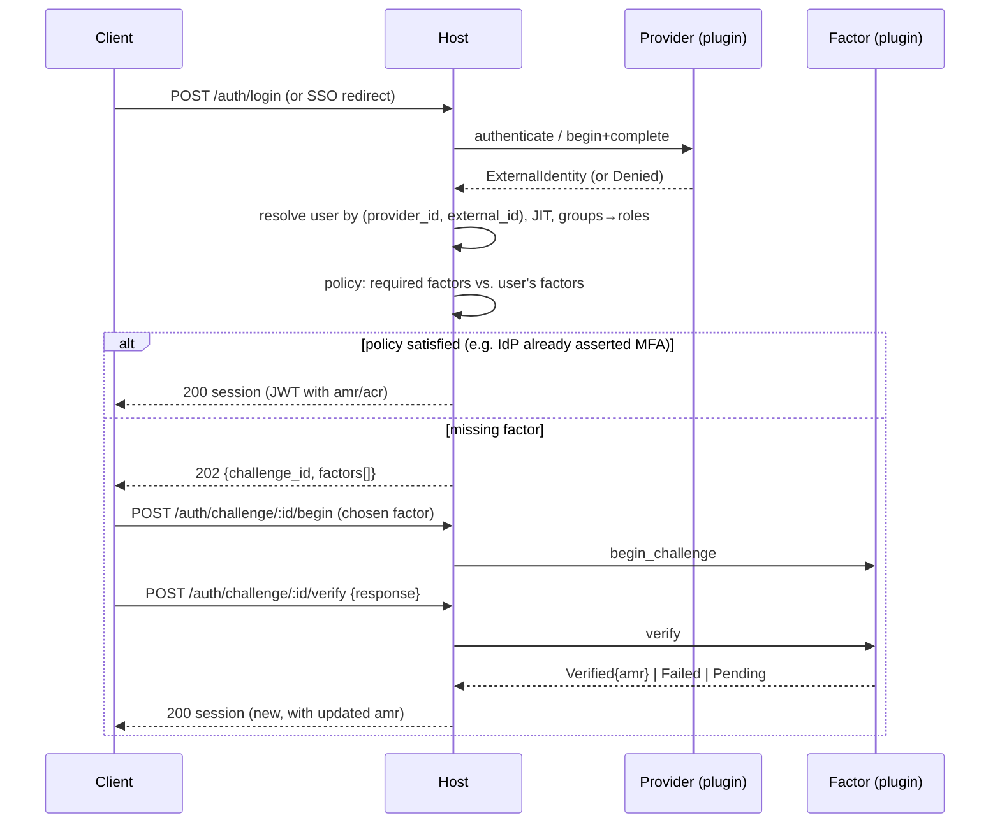
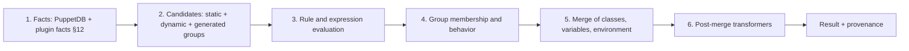

# OpenVox WebUI Plugin Platform — Design v2

Status: **Proposal** (no implementation yet)

Complements [PLUGIN_SYSTEM.md](PLUGIN_SYSTEM.md). That document defines the *typed extension points* (auth, users, secrets, menus, pages, API proxy). This document defines the **platform** they run on: sandbox, permissions, mandatory signing, lifecycle, UI slots, event bus, SDK and governance, plus the domain extensions: authentication (MFA, SSO, LDAP/AD, §11), reports and facts (§12) and advanced classification and dynamic groups (§13). Where the two conflict, this document prevails (see §16).

**Out of scope for now:** multi-tenant (isolation per organization) and marketplace/plugin store. The design assumes **one instance, one set of administrators**, and manually installed plugins. §18 records what was deferred and the decisions made here so that bringing those items back is not blocked.

## 1. What we learned from Jira, Drupal and Joomla

| Aspect | Jira / Atlassian Forge | Drupal | Joomla | What we adopt |
|---|---|---|---|---|
| Declaration | `manifest.yml` with `app`, `modules`, `permissions` | `*.info.yml`, `*.services.yml` | XML manifest with `group` | A single `plugin.yaml` manifest (§4) |
| Extension points | Typed *modules* (issue panel, function, trigger) | Hooks, Events (Symfony), Plugins (annotations), Services | Plugins grouped by `group`, loaded before dispatch | Typed extension points + named UI slots (§8) |
| Permissions | Scopes declared in the manifest, visible to the admin | Per-module permissions, no sandbox | Component ACL, no sandbox | Declared capabilities + approved by the admin (§6) |
| Isolation | Functions in a managed runtime, UI in a sandboxed iframe with CSP and a declared *egress allowlist* | **None** (PHP code in the core process) | **None** | Strong isolation by default: WASM + iframe + egress allowlist (§5) |
| Events | Product triggers | `hook_*` and subscribers with ordering **weight**; *alter* hooks mutate data | `SubscriberInterface::getSubscribedEvents()`; internal dispatcher | Event bus with priority; notify-only in v1, restricted interceptors in v2 (§9) |
| Install/upgrade | Managed by the platform | `hook_install`, `hook_update_N` (schema version = highest N), `hook_uninstall` | install script | Versioned declarative migrations, run by the host (§7) |

Key lessons:

1. **Drupal and Joomla prove flexibility, but run module code inside the core process.** One bad plugin takes everything down. We copy the *extensibility* model (named hooks, priority, typed groups, versioned migrations), not the *execution* model.
2. **Forge proves the declarative model works**: manifest → the admin sees the permissions before installing → the platform enforces them. UI isolated in an iframe with CSP and declared egress is the pattern to follow.
3. **Hooks that mutate data (alter) are a common source of conflicts and performance bugs** in Drupal. That is why v1 is notify-only.

> Note on sources: web research confirmed Forge's manifest/scopes/egress/iframe, Drupal's hooks vs. events vs. plugins vs. services, `hook_install/uninstall/update_N`, and the dispatcher/subscriber/group model of Joomla 5. Forge's execution limits (memory, timeout, storage quotas) and Joomla's `script.php` were **not confirmed**; the quota values below are our own decisions, not copies.

## 2. Principles

1. **Nothing is trusted by default.** Every third-party plugin runs isolated. Trusted code (builtin) is explicit and compiled in.
2. **The host authorizes, the plugin executes.** A plugin never receives a database pool, JWT key, config or secret that has not been granted to it.
3. **Plugins cannot see each other.** Storage, config and secrets are per plugin; only the Host API gives access to core data, filtered by capabilities and, when acting on behalf of a user, by that user's RBAC.
4. **Fail closed, limited blast radius.** Timeout, quota, circuit breaker; a faulty plugin is disabled, the core keeps running.
5. **Everything is observable and auditable**, per plugin.

## 3. Overview



### 3.1 Runtimes (revision of the decision in PLUGIN_SYSTEM.md §2)

The previous design chose `builtin` + `remote` and deferred WASM. Since the explicit requirement is now *sandboxing third-party code*, **WASM becomes the default backend runtime**; `remote` remains for integrations that need their own process/language/infrastructure (LDAP, Vault).

| Runtime | When to use | Isolation | Limits |
|---|---|---|---|
| `wasm` (default) | Event handlers, API routes, jobs, transformations, validations | Own linear memory, no syscalls; only host imports (WASI with no FS/network by default) | `fuel` (CPU), max memory, max time per invocation, concurrent instances |
| `remote` | Integration that requires its own process (LDAP auth, secret provider) | Process and network boundary, mTLS | timeout, circuit breaker, controlled host egress |
| `builtin` | Local/SAML auth, `env`/`file` providers | None (trusted) | First-party only, Cargo feature flag |

Technical choice for WASM: `wasmtime` with the **Component Model + WIT** to define the contract (`openvox:plugin/host`, `openvox:plugin/handler`), which generates typed bindings for Rust, TypeScript (via `jco`), Go and others. New instance per invocation (or a pool with reset); `Store` with `ResourceLimiter` and `consume_fuel`. New dependency to add to `Cargo.toml` (today there is no wasmtime/extism/libloading).

Alternative considered: Extism (simpler API, less fine-grained control over limits). Recommendation: wasmtime directly.

## 4. Package and manifest

### 4.1 `.ovxp` package

A zip (or tar.zst) file with a fixed layout:

```
plugin.yaml            manifest (§4.2)
MANIFEST.sha256        SHA-256 of every file in the package
plugin.sig             ed25519 signature over MANIFEST.sha256 and header (mandatory, §4.3)
backend/plugin.wasm    WASM component (wasm runtime)
ui/                    static assets (iframe) and/or remoteEntry.js (module federation)
migrations/            0001_init.up.sql, 0001_init.down.sql, ...
i18n/                  pt-BR.json, en.json
README.md, CHANGELOG.md, LICENSE
```

The host computes the package SHA-256 at install time and pins it (`plugin_versions.package_sha256`). A mismatch at load time blocks the plugin.

### 4.2 `plugin.yaml` (extension of the manifest in PLUGIN_SYSTEM.md §3)

```yaml
api_version: 2                 # major of the plugin API (semver)
id: acme-crm-sync              # [a-z0-9-], immutable, unique
name: ACME CRM Sync
version: 1.4.0
publisher: ACME Corp
min_webui_version: 0.45.0
license: Apache-2.0

runtime:
  kind: wasm                   # wasm | remote | builtin
  entry: backend/plugin.wasm
  limits:                      # requested by the plugin; the host applies min(requested, configured ceiling)
    memory_mb: 64
    fuel_per_call: 50_000_000
    timeout_ms: 2000

capabilities:                  # §6; anything not listed here is denied
  - nodes:read
  - kv:rw
  - db:own                     # the plugin's own database (§7.2)
  - events:subscribe
  - events:publish:acme.*
  - email:send
  - http:egress:
      hosts: [api.acme-crm.com]   # mandatory allowlist

events:
  subscribe:
    - { type: node.classified, priority: 100 }
    - { type: report.received, priority: 100, filter: "status == 'failed'" }
  publish: [acme.crm.synced]

contributes:
  slots:                       # §8
    - { slot: node.detail.tabs, id: crm, render: iframe, src: ui/crm.html }
    - { slot: dashboard.widgets, id: crm-status, render: declarative, spec: ui/widget.json }
  menus: [ ... ]               # PLUGIN_SYSTEM.md §4
  api_routes: [ ... ]          # PLUGIN_SYSTEM.md §9
  jobs:
    - { id: nightly-sync, cron: "0 3 * * *", handler: on_nightly }
  webhooks:
    - { id: crm-inbound, auth: hmac-sha256, handler: on_crm_webhook }

config_schema: { ... }         # JSON Schema; x-secret fields are encrypted and write-only

migrations: { dir: migrations, target: 3 }
lifecycle: { on_install: install, on_upgrade: upgrade, on_uninstall: uninstall }
telemetry: { declared_pii_fields: [email] }   # LGPD (Brazilian data protection law; §14)
```

Validations at install: unique `id`, supported `api_version`, each `contributes` entry requires the corresponding capability, sanitized strings, icons from an allowlist, namespaced permissions `plugin.<id>.*`, `http:egress.hosts` with no broad wildcard and no link-local/metadata IPs.

### 4.3 Mandatory signing and trusted keys

**Every plugin must be signed, without exception and without an option to turn it off** (there is no `require_signed: false`). A package that is unsigned, has an invalid signature, or is signed by an unknown, expired or revoked key is rejected at install time **and** at load time (startup and before activation). Local development follows the same rule: the developer generates a key pair with `openvox-plugin keygen`, signs with `openvox-plugin sign`, and the administrator adds the public key as trusted (label "dev"). There is no bypass.

**What is signed**: ed25519 over `MANIFEST.sha256` (SHA-256 of every file in the package, including `plugin.yaml`) plus a header `{id, version, api_version, key_id, signed_at}`. This way a file inside the package cannot be swapped, and a valid signature cannot be reused for another `id` or version. The `key_id` is the SHA-256 of the public key (fingerprint).

**Origin of trusted keys**

| Origin | Description | Can be removed? |
|---|---|---|
| `builtin` | OpenVox project keys embedded in the WebUI, for first-party plugins | No; only changes with a WebUI update |
| `admin` | Keys added in the interface (below) | Yes, by whoever has `plugins:trust` |

**Continuous verification**: in addition to install time, the host re-verifies the signature at load time and periodically checks the hash of the files on disk against the manifest, to detect tampering. Mismatch → the plugin goes to `error` (reason `integrity_failed`) and the admin is notified.

**Revocation and expiry**: when a key is revoked or expires, every plugin whose signature comes *only* from it becomes `disabled` (reason `signer_revoked` or `signer_expired`), with data preserved. The admin recovers by installing a version signed by another trusted key. Alert 30 days before expiry.

**Key scope** (optional, reduces the damage of a compromised key): `allowed_plugin_ids` limits which plugins it may sign (default: any).

#### Interface: Plugins → Trusted keys

A dedicated permission, **`plugins:trust`**, separate from `plugins:admin` (separation of duties): whoever has only `plugins:admin` can install only plugins signed by keys that are already trusted and cannot widen the list.

- **List**: label, fingerprint, origin, who added it and when, validity, scope, state (active/revoked/expired) and which installed plugins depend on it.
- **Add by paste or file**: public key (PEM/base64 or `.pub`), label, validity and scope. The UI shows the computed fingerprint.
- **Add during the install flow** ("trust this key"): when uploading a package signed by an unknown key, the installation pauses and shows the fingerprint, publisher, `id`/version and the package's capabilities. To confirm, the administrator types the first 8 characters of the fingerprint, which forces them to compare it with the value received over another channel (mitigates the risk of trust on first use). Only then is the key stored and the installation continues.
- **Revoke** (reason required), **edit** label/validity/scope and **remove** (key with no dependent plugins).
- **Optional two-approver rule** (`plugins.trust.require_second_approver`): the key only takes effect after approval by a second administrator with `plugins:trust`.
- Adding or revoking a key requires **re-authentication** (step-up, §11.3), is audited and emits the event `plugin.trust.key_added` / `key_revoked`.

API (all require `plugins:trust`, except listing, which accepts `plugins:admin`):

```
GET    /api/v1/plugins/trust/keys
POST   /api/v1/plugins/trust/keys                  adds (public_key, label, expires_at, allowed_plugin_ids)
GET    /api/v1/plugins/trust/keys/:key_id
PATCH  /api/v1/plugins/trust/keys/:key_id          label, validity, scope
POST   /api/v1/plugins/trust/keys/:key_id/revoke   {reason}
DELETE /api/v1/plugins/trust/keys/:key_id
POST   /api/v1/plugins/preflight                   uploads the package, returns signature, signer and capabilities without installing
```

## 5. Isolation and security (sandbox)

### 5.1 Backend

- **WASM**: no access to FS, network, high-resolution clock or environment variables. The only channel to the outside world is the *Host API* (§6.3), and every call goes through the **Capability Gate**.
- **Outbound network**: the plugin does not open sockets. `http.fetch` is a host function; it applies the manifest's host allowlist ∩ what the admin approved, blocks private/link-local/metadata IPs (SSRF guard, validated after DNS resolution and on every redirect), and limits body size and timeout.
- **Resources**: fuel per call, memory ceiling per instance, maximum time, per-plugin concurrency with a bulkhead. Exceeded → call aborted, telemetry event and a count toward the circuit breaker.
- **Remote**: mTLS or bearer, timeout, circuit breaker; the host never forwards the user's cookies or `Authorization` (PLUGIN_SYSTEM.md §9).
- **Process**: WASM invocations run in the host process but with no access to host memory; a plugin `trap` becomes a handled error, never a server panic. Host-side panics inside the call are contained (`JoinError` in `tokio::spawn`).

### 5.2 Frontend

| Type | Isolation | When |
|---|---|---|
| `declarative` | No third-party JS; JSON rendered by host components | Recommended default |
| `iframe` | `sandbox="allow-scripts allow-forms"` **without** `allow-same-origin`, distinct origin, CSP `frame-src`/`connect-src` derived from the approved egress, postMessage with handshake and validation of `event.origin`/`source` | Rich third-party UI |
| `module` (Module Federation) | **Same origin and same JS context as the host**: no isolation | Only `trusted` plugins (first-party or marked by the admin), with SRI; off by default (`plugins.allow_trusted_modules: false`) |

Module Federation is on the requested list (on-demand loading, without inflating the bundle), but **it is the only option without a sandbox**; that is why it is restricted to trusted code. For third-party code, the iframe also loads on demand and preserves isolation. A conscious departure from the original brief.

## 6. Permissions (capabilities) and approval

### 6.1 Model

Capability = `<domain>:<action>[:<scope>]`. Examples: `nodes:read`, `facts:read`, `reports:read`, `users:read`, `kv:rw`, `db:own`, `email:send`, `events:subscribe`, `events:publish:acme.*`, `http:egress`, `secrets:resolve:<prefix>`, `ui:slot:<slot>`, `audit:write`, `auth:provider`, `auth:factor`, `auth:credentials` (receives the password in clear text, critical risk), `users:provider`, `facts:provide`, `facts:read`, `facts:export:external` (high risk), `reports:read`, `reports:provide`, `reports:annotate`, `reports:export:format`, `datasets:read`, `classification:operators`, `classification:membership`, `classification:templates`, `classification:behaviors`, `classification:inject` (high risk), `groups:read`, `groups:write:own`.

The **intersection** applies:

```
effective = declared (manifest) ∩ approved (admin with plugins:admin) ∩ policy ceiling (config.yaml: plugins.policy)
```

### 6.2 Approval flow

1. An admin with `plugins:admin` uploads the `.ovxp` (upload, URL or local directory) under "Install". The host verifies the signature (§4.3) **before** showing anything; without a valid signature from a trusted key, the installation is refused (or pauses in the "trust this key" flow, for those who have `plugins:trust`).
2. The screen lists **each capability in plain language**, with a risk level (read/write/outbound network/PII) and the egress hosts.
3. The admin approves **per capability** (can deny optional ones; the plugin declares `optional: true` and must work in a degraded mode).
4. `plugin_grants` is written with who/when. Audited.
5. **An update that adds a capability requires a new approval**; the new version stays pending and the previous one remains active.

### 6.3 Host API (WASM and remote side)

Same surface for both runtimes (WIT for WASM; HTTP with a plugin token for remote, per PLUGIN_SYSTEM.md §8): `nodes.list/get`, `facts.get`, `reports.query`, `kv.get/put/delete`, `db.query/exec` (§7.2), `http.fetch`, `email.send`, `notify.send`, `events.publish`, `secrets.resolve`, `audit.write`, `log.write`, `config.get`. Every function implicitly receives the `(plugin_id, version)` context; the plugin does not choose who owns the data it reads or writes.

### 6.4 Integration with the existing RBAC

Plugins **do not replace** the core RBAC. Permissions to use a contribution (`plugin.<id>.<resource>`) are registered in the RBAC tables on activation and removed on uninstall, never automatically assigned to roles (PLUGIN_SYSTEM.md §11). When the plugin acts *on behalf of* a user, the intersection with that user's RBAC applies (delegated assertion). Background access (jobs, event handlers) uses only the approved capabilities, with no user.

## 7. Lifecycle and storage

### 7.1 States and hooks

```
installed → configured → enabled ⇄ disabled → uninstalled
                       ↘ error (health/circuit breaker)    ↘ update_pending (new version awaiting approval)
```

Lifecycle hooks (exported function of the WASM or endpoint of the remote): `install`, `upgrade(from,to)`, `enable`, `disable`, `uninstall(purge: bool)`. The host calls them; the plugin can only access what its capabilities allow during the hook. Short timeout and execution is recorded.

### 7.2 Plugin storage

Two layers, both accessed **only** via the Host API:

1. **`kv`**: key/value per `plugin_id` with a quota (default 10 MB, 10,000 keys).
2. **`db:own`**: a SQLite database **dedicated to each plugin** (`<data>/plugins/<plugin>.db`). A file boundary, not a `WHERE` clause: one plugin cannot reach another's data, uninstalling is deleting the file, and per-plugin backup/export is trivial.
   - The plugin sends parameterized SQL; the host runs it on that file's connection. Restrictions: no `ATTACH`, no `load_extension`, `PRAGMA trusted_schema=OFF`, a size limit (`max_page_count`) and a per-query duration limit. *Proven in the M18 PoC: `lock_handle()` plus libsqlite3-sys for the authorizer and sqlx's progress handler for the time limit (see PLUGIN_POC_RESULTS.md).*
   - Plugins **never** touch the core tables or the `inventory` DB.

Core data only reaches the plugin through the Host API with the corresponding capability. Node data comes from PuppetDB and today the core RBAC controls who sees it; handlers with no user receive whatever the approved `nodes:read` capability allows (no per-organization scoping, see §18).

### 7.3 Migrations

Instead of Drupal's imperative `hook_update_N`, **declarative migrations**: `migrations/NNNN_name.up.sql` and `.down.sql`, applied by the host to the plugin's `db:own`, with the version in `plugins.schema_version` (Drupal's "schema version = highest N" idea). Transaction, `checksum` per file; failure → rollback and the plugin stays in `error`, with no partial state. Upgrade is only allowed if a complete path exists; downgrade uses the `.down.sql` files. `uninstall(purge: true)` deletes data; `purge: false` retains it for N days (default 30) for reinstallation.

### 7.4 Versioning and updates

- `version` is semver; `api_version` is the host API major. The host supports N and N-1; incompatible ones are installed but stay `disabled` with a reason.
- **Several versions stored, one active** (`plugin_versions` holds the installed ones; `plugins.active_version` points to the one in use). Enables immediate rollback.
- **Update**: manual, batch (admin selects several) or **scheduled** (configurable window), reusing the `*_scheduler.rs` pattern (there is `cron` in `src/services/scheduler.rs`).
- **Rollback**: reactivates the previous version; if there was a migration, runs `.down` (if absent, rollback is blocked and the admin is warned *before* updating).
- An update that adds a capability: pending until approval (§6.2).
- **Local revocation**: the admin can mark a version as revoked (or use a list of blocked hashes in `config.yaml`); the host deactivates it.

### 7.5 Testable guarantees (become acceptance tests)

- Plugin A cannot read plugin B's kv, database, config or logs.
- A plugin without `nodes:read` gets 403 on `nodes.list`; without approved egress, `http.fetch` is denied.
- A plugin that exceeds fuel, memory or time is aborted without affecting the core or other plugins.
- An update that adds a capability does not activate the new version without approval.
- Uninstalling with `purge` removes kv, database, RBAC permissions, jobs, event subscriptions and secrets.

## 8. UI extensibility (slots)

### 8.1 Slots

Slots are named, stable points with a typed **context contract**. They replace the literal array in `frontend/src/components/Layout.tsx` (menu) as the basis of a registry.

| Slot | Context provided | Examples |
|---|---|---|
| `nav.main`, `nav.admin`, `nav.user-menu` | user | menu items (PLUGIN_SYSTEM.md §4.1) |
| `toolbar.global` | user, current route | buttons in the top bar |
| `dashboard.widgets` | period | cards on the Dashboard |
| `node.detail.tabs`, `node.detail.actions` | `certname`, summarized facts | CRM tab on the node |
| `group.detail.panels` | `group_id` | extra panel on the group |
| `report.detail.panels` | `report_hash` | custom analysis |
| `footer.global` | — | footer |
| `settings.sections` | — | plugin config section |
| `profile.security` | user | manage one's own factors (MFA) |
| `admin.auth` | — | authentication policies and providers |
| `node.detail.facts` | `certname` | section with plugin facts (§12) |
| `report.list.columns`, `report.export.actions` | filters | extra columns and export actions |
| `reports.builder.sources` | — | data sources in the report builder |
| `group.rule.editors`, `group.members.columns` | `group_id` | contributed operator editor; member columns (§13) |
| `classification.explain.panels` | `certname` | extra panels in the classification explanation |

The login screen is **not a slot**: it is pre-authentication, so only the host renders it (§11.6).
| `page` | route `/p/<plugin>/...` | full screen |

Each slot has **`order` and `max_items`**; the admin can reorder, hide contributions per slot and set priority between plugins. Hiding is cosmetic (security stays in RBAC/API). Slots are filtered on the server by user permission (`GET /api/v1/plugins/ui/slots?route=...`), without leaking metadata. The slot catalog is versioned and is part of the public plugin API; removing a slot requires a major bump.

### 8.2 Dynamic theme

The frontend today only has a light/dark theme (`frontend/src/stores/themeStore.ts`). Contract for plugins: **design tokens as CSS custom properties** (`--ov-color-primary`, `--ov-font-body`, `--ov-radius`, …) plus light/dark mode.
- `declarative` and `module`: inherit automatically (same DOM, same tokens).
- `iframe`: the host sends the tokens via postMessage in the handshake and on every theme change; the SDK injects them into the iframe's `:root`. A `@openvox/plugin-ui` package offers components that consume the tokens.
- The host only accepts token **values** from the allowed list (no arbitrary CSS coming from a plugin).

Configurable branding (logo, colors, fonts) **does not exist today and is deferred** (§18). The token contract already supports it when it exists: the host simply starts emitting other values.

### 8.3 On-demand loading

Plugins never enter the main bundle. `declarative`: JSON fetched when the slot opens. `iframe`: loaded when the slot mounts, with `loading="lazy"`. `module` (trusted only): `remoteEntry.js` loaded dynamically on first render, with `react`/`react-dom` as shared singletons.

## 9. Communication: event bus, SDK and webhooks

### 9.1 Event bus

Envelope:

```json
{ "id": "01J...", "type": "node.classified", "schema_version": 1,
  "occurred_at": "…", "actor": {"kind":"user|system|plugin","id":"…"},
  "payload": { … }, "correlation_id": "…" }
```

- **Existing base**: `NotificationService` already uses `tokio::sync::broadcast` (`src/services/notification.rs`). It works for in-memory fan-out, but **loses events on restart and does not guarantee delivery**. Proposal: an `event_outbox` (SQLite) written in the same transaction as the state change, and a dispatcher that reads the outbox, delivers and marks. **At-least-once** semantics with idempotent `id`; retry with exponential backoff; dead-letter after N attempts, visible to the admin.
- **Core event catalog** (versioned): `auth.login.success|failure`, `auth.factor.enrolled|removed|failed`, `directory.sync.finished`, `plugin.trust.key_added|key_revoked`, `report.generated`, `plugin.fact.updated|stale`, `classification.changed|degraded`, `group.created|updated|deleted`, `group.membership.changed`, `membership.held`, `user.created|updated|deactivated`, `node.registered|classified|removed`, `report.received`, `deploy.started|finished`, `alert.fired`, `plugin.installed|enabled|disabled|upgraded`.
- **Plugin events**: namespace `<plugin-id>.*`, declared in `events.publish`; other plugins can subscribe if they have the capability. Enables composition between plugins without coupling.
- **Order and priority**: per event, handlers run by `priority` (like module weights in Drupal) and, on a tie, by `plugin_id`. No global ordering guarantee between events.
- **Filter**: a simple expression over the payload (`filter`) evaluated by the host *before* waking the WASM, which saves CPU.

### 9.2 Interceptors (v2, restricted)

*Before/alter* hooks (veto or mutation) are useful but dangerous. **v1 is notify-only.** In v2, only on events explicitly marked `interceptable` (e.g. `before.node.classify`), with a 50 ms timeout, fail-open or fail-closed defined *by the event* (not by the plugin), a maximum of 3 interceptors per event and dedicated telemetry.

### 9.3 SDK

One contract (WIT) → generated SDKs: the `openvox-plugin-sdk` crate (Rust) and the `@openvox/plugin-sdk` package (TypeScript, backend via jco and frontend via postMessage).

```ts
// frontend (iframe)
const ctx = await app.getContext();                // {user, locale, theme, slot, params}
app.showNotification({ level: "success", text: "Synced" });
const nodes = await app.api.fetch("/nodes?limit=20"); // host proxy, user's RBAC, no exposed token
app.navigate("/nodes/web01");
app.on("theme.changed", applyTokens);
```

```rust
// backend (WASM)
#[openvox::handler(event = "node.classified")]
fn on_classified(ev: Event<NodeClassified>, host: &Host) -> Result<()> {
    let node = host.nodes().get(&ev.payload.certname)?;
    host.http().post("https://api.acme-crm.com/nodes", &node)?;   // only if on the allowlist
    host.kv().put("last_sync", now())?;
    Ok(())
}
```

Every SDK function validates input, applies the Capability Gate and produces telemetry and audit records. Schemas and documentation are published in `docs/api/plugins/`.

### 9.4 Webhooks

- **Outbound** (plugin → external): via `http.fetch` with an allowlist (no free egress), or an event subscription with delivery by webhook managed by the host (HMAC-SHA256, retry, dead-letter). *Today the repository only has inbound webhooks (`src/api/code_deploy.rs`), so the outbound engine is new.*
- **Inbound** (external → plugin): `/api/v1/plugins/<id>/webhooks/<hook-id>`, **no session**, but with mandatory `auth: hmac-sha256` (per-plugin secret, generated by the host, rotatable, constant-time comparison, timestamp-based anti-replay window), its own rate limit and a body limit. Resolves open question 1 of the previous doc: routes without a session only exist as a signed webhook or a host `/auth/*` flow.

## 10. Governance and telemetry

### 10.1 Metrics per (plugin, version)

Collected in the host on every invocation, without depending on the plugin:

| Metric | Detail |
|---|---|
| Invocations, errors, traps, timeouts | per handler (event, route, job, hook) |
| Latency | p50/p95/p99 |
| CPU | fuel consumed |
| Memory | peak per instance, average |
| Network | outbound bytes and calls, hosts, failures |
| Storage | kv and size of `db:own` |
| Events | delivered, pending, dead-letter, outbox lag |
| Impact on the core | latency added to requests that go through slots/proxy |

Exposure: a `/metrics` endpoint (Prometheus) with `plugin`, `version` labels, plus an aggregated `plugin_usage_hourly` table for the UI (charts in recharts, already used in the frontend).

### 10.2 Quotas and protection

- Global and per-plugin ceilings (memory, fuel, invocations/min, egress/day, storage). The manifest *requests*; the lower value applies.
- **Circuit breaker**: N failures or overruns in a window → the plugin goes to `error`, extension points are taken out of play, the admin is notified, re-enable attempts with backoff.
- **Kill switch**: the admin disables one plugin or all (`plugins.enabled: false` in `config.yaml`) without deleting data.
- **Performance regression**: alert if the new version worsens p95/errors compared with the previous one (useful right after an update).

### 10.3 Administrator dashboard

An admin page with installed plugins, version, state, health, consumption, top consumers, outdated and revoked versions. It shows aggregates, without payload content.

### 10.4 Logs and audit

- A plugin's `log.write` goes to the structured log with `plugin`, `version`, `correlation_id`; maximum level and rate are limited, **no secrets or declared PII** (redaction).
- Audit (existing `audit_log` table): install, enable, grant capability, update, config, uninstall, secret access, proxied write, login failure via plugin.

## 11. Authentication and identity (MFA, SSO and directories)

Deepens PLUGIN_SYSTEM.md §5 and §6. In case of conflict, this text prevails.

### 11.1 Current state and the problem

- Local login: `POST /api/v1/auth/login` calls `AuthService::authenticate` and **issues a session and tokens immediately** (`src/api/auth.rs`). There is no point between "password correct" and "session issued", so today there is nowhere to fit a second factor.
- SAML: `/saml/login`, `/saml/acs` (`src/api/saml.rs`), with `users.auth_provider` and `users.external_id` (`migrations/20260106000002_saml_auth.sql`).
- There is no MFA, OIDC or LDAP/AD in the code.

Consequence: login must become a **stateful pipeline**, in the host. Plugins come in as pieces of that pipeline, never as its owners.

### 11.2 Three kinds of extension point

| Type | Question it answers | Capability | Examples |
|---|---|---|---|
| **Auth provider** (primary factor) | "Who are you?" | `auth:provider` | LDAP/AD (bind), RADIUS, OIDC, SAML, CAS, client mTLS |
| **Auth factor** (MFA engine) | "Prove it again, with something else" | `auth:factor` | TOTP, WebAuthn/FIDO2, push (Duo, Okta), SMS/e-mail OTP, hardware token, RADIUS challenge |
| **User provider** (directory) | "Who exists and which groups do they belong to?" | `users:provider` | LDAP/AD, SCIM, HR system |

A single plugin can contribute more than one type (the LDAP/AD plugin is an authentication provider by bind **and** a directory).

### 11.3 Authentication pipeline, MFA and step-up



Pipeline rules:

1. **The plugin authenticates and verifies; the host decides and issues the session.** A provider returns `ExternalIdentity`; a factor returns `Verified`/`Failed`. No plugin mints a token or assigns a role that the admin has not mapped.
2. **Challenge** (`auth_challenges`): opaque, single-use, short TTL (5 min), bound to the already-validated primary identity and to an IP/User-Agent hash. There can be several rounds (e.g. password → TOTP → push approval). No session until the policy is satisfied.
3. **Policy** (`auth_policies`): the admin defines when to require which factors, by role, external group, originating provider, originating network or new device. The policy computes the required level; the user chooses among the factors they have enrolled.
4. **`amr` and `acr` in the session**: the JWT now carries the methods used (`pwd`, `otp`, `hwk`, `fed`, …) and a level (`acr`). Each new step produces a **new session** (prevents fixation).
5. **Step-up**: sensitive endpoints (managing users, roles, plugins, trusted keys, secrets) declare a minimum `acr`. If the session does not have it, the response is `401 step_up_required` with the requested level, and the UI opens a challenge without dropping the session.
6. **Compatibility**: with no MFA policy, `POST /auth/login` keeps returning `200` with a session, as today. `202` only appears when a policy requires a factor.
7. **Fail closed**: an unavailable factor or provider, a malformed response, an invalid signature or a timeout equals `Denied`. If the policy requires a factor whose plugin is down, login is denied, except through the emergency path below.
8. **Emergency path (break-glass)**: the `local` provider and the local admin cannot be disabled by a plugin. That admin has TOTP and sealed recovery codes, and every use is audited with an alert.

**Built-in factors** (first-party, to prove the abstraction): TOTP (RFC 6238, ±1 step window, each step accepted **only once**), recovery codes (hashed with argon2, which is already among the dependencies) and WebAuthn/FIDO2. Third-party factors (Duo, RADIUS, SMS) come as plugins.

**Who stores the enrollment data** (TOTP seed, WebAuthn credential): the host, in `user_factors.data_encrypted`, encrypted with the service already used for backups. The plugin receives this data **only during the challenge of the user in question** and can return a new state (counter, `sign_count`), which the host writes atomically. Factors that keep state externally (push, RADIUS) use `external` mode: the host stores only a reference.

### 11.4 SSO (redirect flows)

- The plugin implements the protocol (OIDC authorization code with PKCE, SAML, CAS); the **host controls the edge**: fixed `redirect_uri` `/api/v1/auth/providers/:id/callback`, generation and custody of `state`/`nonce` in `auth_flow_state` (single-use, 10 min), binding to the browser via cookie (prevents *login CSRF*), and a `return_to` allowlist (prevents *open redirect*). No plugin registers its own callback route.
- ID token validation in the plugin: `iss`, `aud`, `exp`, `nonce`, signature via JWKS with caching and rotation.
- **Account linking by `(provider_id, external_id)`**, never by e-mail alone. `email_verified` is only accepted if the admin marked the IdP as authoritative.
- **MFA asserted by the IdP**: if the provider is marked `asserts_mfa: true` by the admin and the IdP's `amr`/`acr` meets the policy, the host does not ask for a second factor. Avoids asking for MFA twice (open question 11).
- Logout: ends the local session and, when the IdP supports it, performs *single logout*/*back-channel logout*, mapping `sid` to the host session.
- The current SAML becomes a built-in provider (`saml_auth.rs`); OIDC is born built-in; other protocols come from plugins.

### 11.5 Directories: LDAP and Active Directory

**Where it runs.** LDAP is TCP, not HTTP, and the WASM sandbox only has `http.fetch`. Therefore:

| Option | Assessment |
|---|---|
| **Built-in LDAP/AD provider in Rust** (`ldap3` crate, Cargo feature `ldap`) | **Recommended for v1**: it is the most common use case, runs under the same traits and the same pipeline, without widening the sandbox surface |
| `remote` plugin (own process, any language) | For third-party directories or unusual protocols; already supported |
| `net:connect` capability in WASM (TCP+TLS with a host:port allowlist) | Possible later; widens the sandbox surface (open question 9) |

**Configuration** (per directory, coming from `config_schema`, secrets via `secret://`): servers (several, with failover), `ldaps://` or StartTLS with **mandatory certificate validation** and a configurable CA (plain `ldap://` only on `localhost`); service account (bind DN + password); `base_dn`; user filter (`(sAMAccountName={u})`, `(userPrincipalName={u})` or `(uid={u})`); attribute mapping (name, e-mail, display name); group search; timeouts and connection pool.

**Bind authentication (search-then-bind)**: the service account looks up the user's DN; the plugin attempts a *bind* with that DN and the supplied password; success returns `ExternalIdentity` with `groups`.

**Active Directory, specific points**
- **Stable identifier**: `objectGUID` as `external_id`. `sAMAccountName`, UPN and DN change when someone is renamed or moved. (OpenLDAP uses `entryUUID`; 389-ds, `nsUniqueId`.)
- **Nested groups**: query with the `LDAP_MATCHING_RULE_IN_CHAIN` rule (`1.2.840.113556.1.4.1941`) or read `tokenGroups`, instead of following `memberOf` recursively.
- **Disabled, expired or locked account**: `userAccountControl` (bit `ACCOUNTDISABLE`), `accountExpires`, `lockoutTime`. Such an account never authenticates, and on sync it is deactivated.
- **Multi-domain forest**: Global Catalog (3268/3269) or one directory configured per domain; referrals off by default.
- **Paging** (RFC 2696) for more than 1000 results.
- Accept `user`, `user@domain` and `DOMAIN\user`.

**LDAP security pitfalls, handled explicitly**
- **Filter injection**: all user input is escaped per RFC 4515 (filters) and RFC 4514 (DNs). Never concatenate `{u}` without escaping.
- **Bind with an empty password**: many servers treat a *bind* with an empty password as a successful anonymous bind. An empty password is rejected **before** talking to the server, and an anonymous *bind* never counts as authentication.
- **User enumeration**: a nonexistent user and a wrong password produce the same response and similar timing (dummy bind when the user does not exist).
- Password never in logs, errors or telemetry.

**Directory usage modes** (per directory, configured by the admin):
- **Lookup**: search for users and groups on the Users/Roles screens, to pre-provision or map groups to roles.
- **JIT**: the user is created on the first successful login.
- **Scheduled sync**: a job following the `*_scheduler.rs` pattern reconciles users and groups (incremental by `uSNChanged`/DirSync when available). A user removed or disabled in the directory is **deactivated, not deleted**, and their sessions and API keys are revoked. Each run writes `directory_sync_runs` and emits `directory.sync.finished`.
- **Group → role mapping** (`auth_role_mappings`) by the group's DN, SID or `objectGUID`, re-evaluated on every login and every sync. A role the admin has not mapped is never granted.
- Users managed by a directory have the identity fields read-only in the UI.

### 11.6 Interface

- **The login screen belongs to the host only.** It is pre-authentication, so no third-party JS runs on it. The host builds it from descriptors: `GET /api/v1/auth/providers` (public) returns providers and, per factor, the schema of the fields (user, password, OTP code) that the host renders. Redirects (SSO) and the WebAuthn client code (`navigator.credentials`) are also the host's; the plugin supplies the options (JSON) and verifies the response.
- **Factor enrollment and management** (slot `profile.security`): the user registers TOTP (QR code generated by the host), a security key, sees recovery codes **only once**, removes factors (requires step-up).
- **Admin** (slot `admin.auth`): providers, MFA policies, group mapping, directories (connection test, manual sync run, history), and resetting a user's factor (audited, requires step-up).
- **WebAuthn behind a proxy**: the RP ID and allowed origins are explicit host configuration (open question 12).

### 11.7 Manifest and contracts

```yaml
capabilities: [auth:provider, auth:factor, users:provider, "secrets:resolve:ldap/*"]
contributes:
  auth_providers:
    - { id: corp-oidc, kind: redirect, label: "Sign in with SSO", icon: KeyRound, asserts_mfa: false }
    - { id: corp-ad,   kind: credentials, label: "Corporate account",
        fields: [username, password] }
  auth_factors:
    - { id: push, kind: push, label: "Approve on your phone", enrollment: external }
    - { id: totp, kind: otp,  label: "Authenticator app",   enrollment: host-managed }
  user_providers:
    - { id: corp-ad-dir, modes: [lookup, jit, sync], paging: true }
```

```rust
#[async_trait]
pub trait AuthFactor: Send + Sync {
    fn descriptor(&self) -> FactorDescriptor;
    /// Returns provisioning data (TOTP QR URI, WebAuthn creation options).
    async fn begin_enroll(&self, ctx: &EnrollContext) -> Result<EnrollStart, FactorError>;
    /// Validates the response and returns the opaque record that the host stores encrypted.
    async fn complete_enroll(&self, ctx: &EnrollContext, resp: Value) -> Result<EnrollRecord, FactorError>;
    /// Triggers the challenge (sends push, generates WebAuthn assertion options).
    async fn begin_challenge(&self, ctx: &ChallengeContext) -> Result<ChallengeStart, FactorError>;
    async fn verify(&self, ctx: &ChallengeContext, resp: Value) -> Result<FactorOutcome, FactorError>;
}

pub enum FactorOutcome {
    Verified { amr: String, new_state: Option<Vec<u8>> },  // new_state: HOTP counter, sign_count
    Failed   { retryable: bool },
    Pending,                                               // push not yet answered
}
```

`AuthProvider` and `UserProvider` follow PLUGIN_SYSTEM.md §5 and §6, with two changes: `AuthOutcome::MfaRequired` is removed (the host pipeline takes over), and `ExternalIdentity` gains the `acr`/`amr` asserted by the IdP and the list of groups with a stable identifier. In the `remote` runtime, the endpoints gain `/auth/factor/{begin_enroll,complete_enroll,begin_challenge,verify}`.

### 11.8 API

```
GET    /api/v1/auth/providers                        (public) providers and field schemas
POST   /api/v1/auth/login                            200 session | 202 {challenge_id, factors[]}
GET    /api/v1/auth/providers/:id/begin              starts SSO flow
GET    /api/v1/auth/providers/:id/callback           IdP return (host route)
POST   /api/v1/auth/challenge/:id/begin              {factor_id}
POST   /api/v1/auth/challenge/:id/verify             {response}
GET    /api/v1/users/me/factors
POST   /api/v1/users/me/factors/:factor_id/enroll/begin | /complete
DELETE /api/v1/users/me/factors/:id                  requires step-up
POST   /api/v1/users/:id/factors/reset               admin, requires step-up, audited
GET/PUT /api/v1/auth/policies                        admin
GET/PUT /api/v1/auth/providers/:id/role-mappings     admin
GET/PUT /api/v1/directories/:id                      admin
POST   /api/v1/directories/:id/test | /sync          admin
```

### 11.9 Specific security requirements

- **A plugin that receives a password in clear text** (`auth:credentials`) is the most dangerous point of the platform, because it could exfiltrate credentials. Mitigations: capability flagged as critical risk at approval; the host **forbids combining it with `http:egress`** for any host other than the declared IdP's; in the `remote` runtime it only talks to the `base_url`; prefer redirect flows; for LDAP/AD, use the built-in provider.
- Rate limit and lockout per user and per IP also on the challenge endpoints (`middleware/rate_limit.rs`, `governor`), constant-time comparison, responses without user enumeration.
- Failed factor attempts count toward account lockout; recovery codes are single-use and stored only as hashes.
- Deactivating or removing a user in the directory revokes sessions and API keys immediately.
- **Audit** (reuses `audit_logs`): every login attempt by a plugin, every factor enrollment/removal/reset, every challenge issued and verified, group-mapping decisions, break-glass use and sync runs. Never the value of the password, OTP or seed.
- Authentication plugins follow the mandatory signing rule (§4.3) and **cannot** be marked `trusted` to run as a module in the browser.
- **LGPD**: the descriptor declares which personal data each provider receives and returns; the admin sees it at install.

## 12. Report and fact extension

### 12.1 Current state

- **Facts**: the values reported by agents live in PuppetDB (`GET /api/v1/facts`, `/facts/names`, `/facts/paths`, `src/api/facts.rs`). Classification receives the facts reassembled into nested JSON by `build_classification_facts` (`src/services/classification.rs`). Separately, `FacterService` (`src/services/facter.rs`) generates **external facts** from *templates* (`FactTemplate`, static values, coming from classification or from other facts) and exports them to the agents at `/api/v1/facter/export/:certname`.
- **Reports**: there are two worlds. (a) Puppet run reports, read from PuppetDB (`/api/v1/reports`, events, daily/hourly summaries). (b) Analytical reports, generated by `ReportingService` (`src/services/reporting.rs`) from a closed `ReportType` enum (`node_health`, `compliance`, `change_tracking`, `drift_detection`, `custom`) and exported in formats that are also closed (`OutputFormat`: csv, pdf, …) (`src/models/analytics.rs`). Types and formats are core code; one cannot be added without changing the binary. I did not go into the generation routes in `src/api/analytics.rs` here.

This section opens up both enums and the fact layer to plugins, without letting the plugin write to PuppetDB or to the core tables.

### 12.2 Plugin facts

Three ways to add facts, with very different risks:

| Type | What it does | Who consumes it | Risk |
|---|---|---|---|
| **Fact provider** (derived) | Computes per-node facts from an external source (CMDB, CVE feed, licenses) | UI, queries, reports and, if enabled, classification rules | Medium (can change classification) |
| **Exportable external fact** | Delivers the facts to **Puppet agents** through the `facts.d` mechanism (`/facter/export/:certname`) | Puppet catalogs and manifests | **High** (influences what runs on the infrastructure) |
| **Fact template** | The plugin supplies ready-made `FactTemplate`s to `FacterService` (new variant `FactValueSource::Plugin{plugin_id, fact_id}`) | Same as above | High |

**Mandatory namespace.** Every plugin fact is named `<namespace>.<name>` (e.g. `acme_cmdb.owner`), where `namespace` is declared in the manifest and unique. A plugin fact **never overwrites** a Facter/PuppetDB fact: if the name collides with one reported by an agent, the agent's wins and the conflict shows up on the plugin's screen.

**Data model and storage.** Values live in a host table, `plugin_facts(plugin_id, certname, name, value_json, computed_at, expires_at)`, written only through the Host API. The plugin does **not** send facts to PuppetDB (PuppetDB remains the source of truth for what the agent reports; see open question 13).

**Retrieval modes**
- `push`: the plugin computes on an event or a scheduled job and calls `facts.put(certname, {name: value})`. It can only write to its own namespace.
- `pull`: the host calls the `resolve(certname, names[])` handler on demand, with a short timeout (default 2 s), cache per `ttl_s` and a *bulkhead*. Failure or timeout becomes "fact missing/stale", **never** an error in `/nodes` or in the listing.

**Schema and validation.** Each fact declares `type` (`string`, `integer`, `float`, `bool`, `list`, `object`), description, optional `enum`, `ttl_s` and `sensitivity` (`none` or `pii`; **`secret` is forbidden**: facts are visible to every catalog and to many people). The host validates each value against the schema, with limits of 16 KB per value and 200 facts per node and plugin, and rejects what does not fit.

**Integration with the rest of the system**
- The catalogs (`/facts/names`, `/facts/paths`) and the node view now show a **merged** PuppetDB ∪ plugin view, with a `source` field (`puppetdb` or `plugin:<id>`) and a badge in the UI.
- `usable_in_rules` (default `false`): only facts the admin enables can be used in classification rules. `build_classification_facts` receives the enabled plugin facts, with `computed_at`.
- `exportable` (default `false`): only facts the admin enables enter `/facter/export`.
- Each fact can declare `requires` (RBAC permission to see it); the API filters the response.

**Classification and plugin facts (sensitive point).** A plugin fact can change a node's environment and classes. Therefore:
1. The rule that uses it shows a "depends on plugin" warning on the group screen.
2. Data older than `max_stale` counts as **missing**; a missing fact does not match the rule (behavior already used for absent facts).
3. Option `classification.freeze_on_provider_failure`: with the provider unavailable, the node keeps its last classification instead of being reclassified for lack of data.
4. Every classification change caused by a plugin fact is audited, with the responsible fact and value.

**Export to agents.** Enabling `exportable` requires the `facts:export:external` capability (high risk, highlighted at approval), per-fact confirmation, a **preview** of the values per node before activating, an audit trail and a size limit. Values are plain JSON, with no control characters.

### 12.3 Plugin reports

**a. New report types.** The `ReportType` enum gains the variant `Plugin { plugin_id, type_id }` (textual id `plugin:<id>:<type>`). The plugin declares parameters (JSON Schema, which the host renders as a form) and a handler `generate(params, ctx) -> ReportResult`. Data arrives through the Host API (`reports.query`, `nodes.list`, `facts.get`, `datasets.query`); the plugin does not access the database. Scheduling, saved reports, history and retention are the core's, with the new type.

The result is **structured**, not HTML: typed sections (`table`, `chart`, `kpi`, `text`) that the host renders and exports uniformly (same principle as declarative pages, §8). Execution as a background job, with fuel, memory, time and a row limit (default 100,000), with chunked delivery (`ctx.emit_rows`) for large volumes.

**b. New export formats.** The plugin declares `export_formats` (xlsx, SARIF, PDF with its own template, JSON for BI) and a handler `render(result, options) -> {bytes, content_type, filename}`. The host only accepts content types from an allowlist, enforces a size limit and always responds with `Content-Disposition: attachment` and `X-Content-Type-Options: nosniff`, never inline, so that an export does not become an XSS vector.

**c. Annotations on Puppet reports.** PuppetDB reports are immutable. A plugin with the `report.received` event can write **annotations** to `report_annotations(report_hash, plugin_id, key, value_json, severity, created_at)`: risk score, ticket link, compliance control. They appear in extra list columns (`report.list.columns`, sortable and filterable if declared) and in detail panels (`report.detail.panels`). The annotation does not alter the original report.

**d. Data sources.** A plugin can register a *dataset* with a schema (e.g. "CVE per node"), queryable by the `custom` report builder and by other plugins (capability `datasets:read`).

**e. Events.** `report.generated` (type, parameters, duration, who requested it), `plugin.fact.updated` (batch per node, not one event per fact) and `plugin.fact.stale`, so that other plugins and alerts can react.

### 12.4 Manifest

```yaml
capabilities:
  - facts:provide                  # declares its own facts (namespace mandatory)
  - facts:read
  - facts:export:external          # optional, high risk
  - reports:read
  - reports:provide                # new report types
  - reports:annotate
  - reports:export:format
  - datasets:read

contributes:
  facts:
    namespace: acme_cmdb
    mode: push                     # push | pull
    ttl_s: 3600
    max_stale_s: 86400
    items:
      - { name: owner,       type: string,  sensitivity: none, description: "Asset owner in the CMDB" }
      - { name: criticality, type: integer, enum: [1, 2, 3, 4],
          usable_in_rules: true, exportable: true,
          requires: { resource: plugin.acme-cmdb.facts, action: read } }
    handler: resolve_facts         # pull mode only
  report_types:
    - id: asset-compliance
      label: Asset compliance
      params_schema: { type: object, properties: { since: { type: string, format: date } } }
      handler: generate_asset_compliance
      schedulable: true
      requires: { resource: plugin.acme-cmdb.reports, action: read }
  export_formats:
    - { id: xlsx, label: Excel, content_type: "application/vnd.openxmlformats-officedocument.spreadsheetml.sheet",
        extension: xlsx, handler: render_xlsx }
  report_annotations:
    - { key: risk_score, type: integer, label: Risk, show_in: [list_column, detail_panel],
        sortable: true, filterable: true }
  datasets:
    - { id: assets, schema: { ... } }
```

Contract (WIT/Rust):

```rust
pub trait FactProvider {
    /// pull mode: resolves facts for a node
    fn resolve(&self, req: FactRequest) -> Result<FactBatch, ProviderError>;
}
pub trait ReportProvider {
    fn generate(&self, ctx: &ReportContext, params: Value) -> Result<ReportResult, ReportError>;
    fn render(&self, format_id: &str, result: &ReportResult, opts: Value) -> Result<RenderedFile, ReportError>;
}
```

### 12.5 Added Host API

| Call | Capability | Note |
|---|---|---|
| `facts.put(certname, map)` | `facts:provide` | own namespace only; validates schema and limits |
| `facts.get(certname, names?)` | `facts:read` | facts from other namespaces require each fact's `requires` permission |
| `reports.query(filter)` | `reports:read` | same surface as the report endpoints |
| `reports.annotate(report_hash, key, value)` | `reports:annotate` | declared keys only |
| `datasets.query(id, filter)` | `datasets:read` | paginated |
| `ctx.emit_rows(chunk)` | `reports:provide` | chunked delivery |

### 12.6 API and UI

```
GET  /api/v1/facts?source=plugin:acme-cmdb               filter by source
GET  /api/v1/nodes/:certname/facts                        merged view, with `source` and `computed_at`
GET  /api/v1/plugins/:id/facts                            catalog, state, last run, failures
PUT  /api/v1/plugins/:id/facts/:name/settings             admin: usable_in_rules, exportable
GET  /api/v1/plugins/:id/facts/:name/preview?limit=50     values per node before enabling
GET  /api/v1/analytics/report-types                       core + plugin types (exact route to be confirmed in src/api/analytics.rs)
GET  /api/v1/reports/:hash/annotations
PUT  /api/v1/plugins/host/facts/:certname                 Host API (plugin token)
```

New slots: `node.detail.facts` (dedicated section for plugin facts), `report.list.columns`, `report.detail.panels`, `report.export.actions`, `reports.builder.sources`.

### 12.7 Security and performance

- **Namespace and no overwriting**: no plugin alters core facts or another plugin's facts. Name collisions are rejected at install.
- **Facts go to agents only with explicit approval** per fact, preview and audit. Facts never carry secrets (`sensitivity: secret` is refused in the manifest).
- **Protected classification**: opt-in per fact, warning on rules, `max_stale`, freezing on provider failure and auditing of every change caused by a plugin.
- **Reports under limits**: async job with fuel/memory/time/rows; result stored in the host with retention and RBAC; the plugin only reads what its capabilities allow; export with a type allowlist, maximum size, `attachment` and `nosniff`; text sections rendered by the host, no raw HTML.
- **Performance**: batched fact writes, *pull* with cache and *bulkhead*, a circuit breaker that marks facts as stale instead of blocking `/nodes`; per-plugin quotas (facts per node, total bytes, simultaneous reports) and telemetry per handler (§10).
- **Uninstall**: `purge` removes the plugin's `plugin_facts` and annotations; saved reports of the plugin's types become `unavailable` (read-only, retained for N days) instead of being deleted; removed facts stop appearing in the export to agents immediately.
- **LGPD**: `sensitivity: pii` is shown at approval, and those facts stay out of exports unless the admin authorizes.
- **Audit**: fact/report installation, enabling `exportable`/`usable_in_rules`, plugin report generation, export, classification change caused by a plugin fact.

## 13. Advanced classification and dynamic groups

### 13.1 Current state

The engine is in `src/services/classification.rs`, with models in `src/models/group.rs` and `src/models/classification.rs`.

- Groups form a **tree** (`parent_id`). Evaluation proceeds breadth-first from the roots, and **a child is only evaluated if the parent matched** (pinned nodes, `pinned_nodes`, bypass this and pull the ancestors in as `Inherited`).
- A rule is **flat**: `fact_path` + `operator` (`=`, `!=`, `~`, `!~`, `>`, `>=`, `<`, `<=`, …) + literal `value`. A group combines its rules only with `All` (AND) or `Any` (OR) (`RuleMatchType`). No nesting, no negation of rule groups, no comparing one fact with another, no functions.
- Groups can have `match_all_nodes`, `environment` (filter) or be `is_environment_group` (assigns an environment).
- Result: classes and variables **merged from root to leaf** (`merge_classes`, `merge_parameters`), the leaf's environment prevails, and `conflict_error` when the node matches groups from different organizations.
- The input is the facts reassembled by `build_classification_facts`. The result feeds `GET /api/v1/nodes/:certname/classification`, which Puppet queries as an ENC (that is, a **hot path with high impact**: wrong classification becomes wrong configuration in production).

Relevant limitations: membership only by static rule or pinning; implicit ordering between sibling groups; a single merge strategy; no external data or time window; no explanation of *why* a node landed in a group.

### 13.2 The staged pipeline, with extension points



| Stage | Plugin extension | Nature |
|---|---|---|
| 1 Facts | Fact providers (§12) | Outside the hot path (push/cache) |
| 2 Candidates | Membership providers (dynamic groups), generated group templates | Asynchronous, materialized |
| 3 Evaluation | Pure **operators** and **functions** for rules and expressions | Pure, on the hot path |
| 4 Behavior | **Group policies** (priority, exclusivity, inheritance, window, canary) | Pure, on the hot path |
| 5 Merge | Per-key **merge strategies** | Pure, on the hot path |
| 6 Transformation | Injection of classes/variables into the plugin's own namespace | Pure; high-risk capability |

**Central principle: the hot path is pure and deterministic.** No network, state or clock inside a node's evaluation. Anything that needs I/O (querying the CMDB, AD, CVE feed) happens **beforehand**, as a fact provider (§12) or a membership provider, and reaches the classifier as already materialized, cached data. This keeps classification fast (target: p95 under 50 ms per node, plugin budget of 20 ms), reproducible and explainable, and prevents a slow external service from taking down the ENC.

### 13.3 Dynamic grouping rules

**a. Composite expressions.** Besides the flat rule, a group can have an `expression`: a boolean tree (`all`, `any`, `not`, nestable) over values and functions.

```json
{ "all": [
    { "fact": "os.family", "op": "=", "value": "RedHat" },
    { "any": [
        { "fn": "semver_gte", "args": [{ "fact": "os.release.full" }, "9.0"] },
        { "fn": "in_cidr",   "args": [{ "fact": "networking.ip" }, "10.20.0.0/16"] } ] },
    { "not": { "fact": "virtual", "op": "=", "value": "physical" } },
    { "op": ">", "left": { "fact": "memory.system.total_bytes" }, "right": { "fact": "acme_cmdb.min_memory" } },
    { "fn": "percentage", "args": [{ "fact": "certname" }, 10, "ring-1"] }
] }
```

- **Compares fact with fact**, uses functions (`lower`, `len`, `semver_gte`, `in_cidr`, `exists`, `percentage`) and lists (`in`).
- Evaluated by a **host interpreter, in Rust, not Turing-complete and bounded** (depth, number of nodes, size). Recommendation: a subset of **CEL** (Common Expression Language), with a canonical JSON form for the API and UI; the alternative is our own AST. Plugins **extend** the vocabulary (pure operators and functions in WASM), they do not replace the evaluator.
- `percentage(certname, n, salt)` is a stable hash: the same node always lands in the same ring, useful for **canary and wave rollouts**.
- `now` is an input **supplied by the host** (minute granularity), which allows time windows without making evaluation impure.
- **Compatibility**: `rules` keep working as today and are translated internally into the same AST. If a group has both `rules` and `expression`, both apply in AND. The UI editor shows the flat rule as a simple case of the expression.

**b. Dynamic groups (materialized).** Group `kind: dynamic`: the member list comes from a plugin **membership provider** (e.g. "nodes with an open critical CVE", "assets flagged as critical in the CMDB", "machines in the Servers OU in AD"). The provider runs on a schedule or event (the `*_scheduler.rs` pattern) and **writes the result** to the host (`membership.replace` or `add`/`remove`). The classifier only queries the materialized table, with no I/O.
- Each member has `computed_at`/`expires_at`. `on_stale` policy: `keep` (keeps the last one), `drop` or `freeze`. Default: `keep` until `max_stale`, then `drop` with an alert.
- **Churn guard**: if an update would add or remove more than X% of the members (default 20%), it is **held** and requires admin approval. Protects the fleet from a faulty provider that reclassifies everything at once.
- Limits: maximum members per group, update rate limit.

**c. Template-generated groups.** "One group for each value of fact X" (`group_by: fact('datacenter')`): the host creates, updates and removes groups as values appear or disappear, with `parent`, classes and parameterized variables (`{{key}}`). Generated groups are marked and read-only, with a per-template limit (default 100) and creation subject to approval when the template comes from a plugin.

**d. External facts in rules.** Any plugin fact with `usable_in_rules` (§12.2) enters expressions and flat rules like an ordinary fact.

### 13.4 Tuning group behavior

Today the behavior is fixed in code. It becomes a set of **per-group policies** (`behavior`), with defaults equal to the current ones and alternative values from the core or from plugins:

| Policy | Default (current behavior) | Alternatives |
|---|---|---|
| `inheritance` | child is only evaluated if the parent matched; classes inherited from the root | `independent` (child matches without the parent), `block` (cuts class/variable inheritance), `select` (inherits only listed keys) |
| `priority` | implicit | integer per group; ties broken by name |
| `exclusive_set` | does not exist | mutually exclusive siblings: the highest priority wins |
| `match_mode` | `All`/`Any` | `n_of(k)`, `weighted(threshold)`, `expression` |
| `merge` (per key) | deep merge, leaf wins | `unique_list`, `union`, `fail_on_conflict`, `by_priority`, plugin strategy |
| `environment` | leaf wins | `strict` (conflict is an error), `most_specific` |
| `lifecycle` | always active | `active_window`, `expires_at`, `sticky` (hysteresis: node stays for N hours after it stops matching, avoids flapping) |
| `on_conflict` | error between organizations | `error`, `first`, `priority` |
| `events` | — | `on_enter`/`on_leave` emit `group.membership.changed` (notification only) |

Plugins can provide **new policies** (`group_behaviors`, e.g. a `canary` with rings) and **new merge strategies**, always as pure functions over a read-only view of the group and the node.

**Backward compatibility**: the default set reproduces the current engine. The migration is **additive** (new columns with defaults), and the scenarios in `tests/features/node_classification.feature` must pass unchanged before any new policy is enabled.

### 13.5 Manifest

```yaml
capabilities:
  - classification:operators          # pure operators and functions for rules/expressions
  - classification:membership         # feeds dynamic groups
  - classification:templates          # creates generated groups
  - classification:behaviors          # group policies and merge strategies
  - classification:inject             # high risk: adds classes/variables to the result
  - groups:read
  - groups:write:own                  # only groups created by the plugin itself

contributes:
  classification:
    functions:
      - { id: semver_gte, args: [string, string], returns: bool, handler: fn_semver_gte }
    operators:
      - { id: cidr_contains, symbol: "cidr", arg_types: [string, string], handler: op_cidr }
    membership_providers:
      - id: cmdb-critical
        label: Critical CMDB assets
        refresh: { cron: "*/15 * * * *" }
        max_stale_s: 3600
        on_stale: keep
        churn_limit_pct: 20
        params_schema: { type: object, properties: { tag: { type: string } } }
        handler: members_cmdb_critical
    group_templates:
      - { id: by-datacenter, group_by: "fact('datacenter')", max_groups: 100, requires_approval: true }
    merge_strategies: [ { id: unique_list, handler: merge_unique_list } ]
    group_behaviors:  [ { id: canary, params_schema: { ... }, handler: behavior_canary } ]
    transformers:     [ { id: compliance-vars, namespace: acme, stage: post_merge, handler: add_vars } ]
```

Contract (WIT/Rust). The evaluation functions are **pure** (no I/O Host API) and run with minimal fuel; only the membership provider has access to the Host API:

```rust
pub trait ClassificationFunction { fn call(&self, id: &str, args: &[Value]) -> Result<Value, EvalError>; }   // pure
pub trait MergeStrategy          { fn merge(&self, key: &str, current: &Value, incoming: &Value, cx: &MergeCx) -> Result<Value, EvalError>; } // pure
pub trait GroupBehavior          { fn adjust(&self, group: &GroupView, node: &NodeView) -> Decision; }                                       // pure
pub trait MembershipProvider     { fn refresh(&self, cx: &RefreshCx, group_id: &str, params: Value) -> Result<MembershipBatch, ProviderError>; } // with Host API
```

### 13.6 Host API, events and provenance

| Call | Capability | Note |
|---|---|---|
| `groups.list/get` | `groups:read` | read-only |
| `groups.create/update/delete` | `groups:write:own` | only groups whose `owner_plugin_id` equals the plugin's; never user groups or other plugins' groups |
| `membership.replace/add/remove(group_id, certnames)` | `classification:membership` | subject to the churn guard |
| `classification.explain(certname)` | `groups:read` | read-only, for diagnostics |

Events (notify-only): `classification.changed` (before/after and cause), `group.membership.changed`, `group.created|updated|deleted`, `classification.degraded`, `membership.held` (update held by the churn guard).

**Provenance**: each class, variable and the result's environment keep their **origin** (group, rule/expression, plugin, merge strategy). The response `GET /api/v1/nodes/:certname/classification?explain=true` brings, per group, the reason for the match (including the expression trace with the evaluated values), the origin of each value, each plugin's latencies and the `degraded` markers. This is what makes it acceptable to have plugins in the classification path.

### 13.7 API and UI

```
GET/POST/PUT /api/v1/groups                       (existing) gains kind, priority, expression, behavior
GET  /api/v1/groups/:id/members                   static + dynamic, with `source` and `computed_at`
POST /api/v1/groups/:id/preview                   {expression|rules|behavior} -> nodes that enter and leave (dry-run)
GET  /api/v1/classification/functions|operators|behaviors|merge-strategies    catalog (core + plugins) with schemas
GET  /api/v1/plugins/:id/classification           providers, last update, held updates
POST /api/v1/groups/:id/membership/approve-held   approves a held update
GET  /api/v1/nodes/:certname/classification?explain=true
PUT  /api/v1/plugins/host/membership/:group_id    Host API
```

The existing routes (`/groups/:id/rules`, `/groups/:id/pinned`, etc.) do not change. New slots: `group.detail.panels`, `group.rule.editors` (visual editor for a contributed operator/rule type), `group.members.columns`, `classification.explain.panels`. The group editor gains an expression builder with a mandatory **impact preview** (how many nodes enter and leave) before saving changes to groups that affect many nodes.

### 13.8 Security, operation and performance

- **High impact**: classification defines what Puppet applies. Therefore (1) pure, deterministic evaluation, (2) plugins only extend the vocabulary, not the control flow, (3) a rule change involving a plugin goes through preview and audit.
- **Safe degradation**: results cached with a version key (facts, groups, plugin versions), invalidated by event. Slow or failing plugin → per-group policy: `freeze` (keeps the last classification, **default** for dynamic groups), `fail_closed` (the node does not receive plugin-defined groups), `fail_open` (only if the admin chooses it, with a warning). It is marked `degraded` and emits `classification.degraded`.
- **Against mass reclassification**: churn guard (§13.3b), update rate limit and an alert on abnormal variation.
- **Ownership isolation**: plugin groups and members have `owner_plugin_id`; the plugin never alters user groups or another plugin's groups. Uninstalling with `purge` removes generated groups and membership; user groups that used the plugin's functions end up with the rule in `unavailable` state (never matches) and the admin is warned, instead of failing silently.
- **Limits**: expression size and depth, members per group, generated groups per template, fuel per pure function call. Regex (`~`) stays on the `regex` crate (linear time); plugin functions go through the fuel budget.
- **`classification:inject`**: the only way for a plugin to add classes/variables; restricted to the plugin's own variable namespace, listed at approval as high risk, always with visible provenance.
- **Multi-organization**: the current logic (`classify_across_organizations`, `conflict_error`) does not change; plugin groups use the default organization while multi-tenant is deferred (§18).
- **Telemetry** (§10): latency per function/operator/policy, cache hit, `degraded` rate, churn per provider, preview runs.
- **Audit**: every classification change caused by a plugin (with the cause), creation/removal of generated groups, approval of held updates, policy activation.

## 14. Cross-cutting security and compliance

- Fail closed, deny by default, hash pinning, mandatory signing (§4.3), mTLS, SSRF guard, sanitization, no `dangerouslySetInnerHTML`: carried over from PLUGIN_SYSTEM.md §13.
- **Package supply chain**: scan of WASM imports at install (only host functions allowed), optional SBOM in the manifest, trusted ed25519 keys managed in the UI with a dedicated permission (§4.3), local revocation.
- **LGPD**: `declared_pii_fields` shown to the admin at install; PII egress requires an explicit capability; retention and *purge* on uninstall.
- **Time**: host `clock` with coarse granularity, to reduce side channels.
- Alignment with the FGV secure development standard/G-002: register each plugin as a system component and treat capability approval as a controlled change.
- Threats and mitigation: malicious plugin (sandbox + capabilities + egress allowlist), slow plugin (fuel/timeouts/bulkhead/circuit breaker), plugin reading another's data (per-plugin kv/db/config), supply chain (hash + signature + local revocation), XSS via plugin UI (iframe without same-origin + CSP + SRI on module), escalation via update (re-approval), DoS via events (filter, quotas, dead-letter).

## 15. Data model (additions)

```sql
plugins(id TEXT PK, active_version TEXT, state TEXT, schema_version INTEGER,
        trusted INTEGER DEFAULT 0, priority INTEGER DEFAULT 100,
        auto_update TEXT, update_window TEXT,
        installed_by TEXT, installed_at TEXT, updated_at TEXT)
plugin_versions(plugin_id TEXT, version TEXT, api_version INTEGER, manifest_json TEXT,
                package_sha256 TEXT, signature TEXT, signed_by_key_id TEXT,
                revoked INTEGER DEFAULT 0, added_at TEXT,
                PRIMARY KEY(plugin_id, version))
plugin_trusted_keys(key_id TEXT PK, public_key BLOB, label TEXT, origin TEXT,   -- builtin | admin
                    allowed_plugin_ids TEXT, expires_at TEXT, state TEXT,       -- active | revoked
                    added_by TEXT, added_at TEXT, approved_by TEXT,
                    revoked_at TEXT, revoked_reason TEXT)
user_factors(id TEXT PK, user_id TEXT, plugin_id TEXT, factor_id TEXT, label TEXT,
             data_encrypted BLOB, state TEXT, created_at TEXT, last_used_at TEXT)
auth_recovery_codes(user_id TEXT, code_hash TEXT, used_at TEXT)
auth_challenges(id TEXT PK, user_id TEXT, primary_provider_id TEXT, required_acr TEXT,
                satisfied_amr TEXT, attempts INTEGER, binding_hash TEXT, expires_at TEXT, consumed_at TEXT)
auth_flow_state(state TEXT PK, provider_id TEXT, nonce TEXT, return_to TEXT,
                browser_binding_hash TEXT, expires_at TEXT)
auth_policies(id TEXT PK, name TEXT, match_json TEXT, required_factors_json TEXT,
              min_acr TEXT, priority INTEGER, enabled INTEGER)
directory_sync_runs(directory_id TEXT, started_at TEXT, finished_at TEXT,
                    created INTEGER, updated INTEGER, deactivated INTEGER, errors INTEGER)
plugin_facts(plugin_id TEXT, certname TEXT, name TEXT, value_json TEXT, computed_at TEXT, expires_at TEXT,
             PRIMARY KEY(plugin_id, certname, name))
plugin_fact_settings(plugin_id TEXT, name TEXT, usable_in_rules INTEGER DEFAULT 0,
                     exportable INTEGER DEFAULT 0, approved_by TEXT, approved_at TEXT,
                     PRIMARY KEY(plugin_id, name))
report_annotations(report_hash TEXT, plugin_id TEXT, key TEXT, value_json TEXT, severity TEXT,
                   created_at TEXT, PRIMARY KEY(report_hash, plugin_id, key))
plugin_datasets(plugin_id TEXT, dataset_id TEXT, schema_json TEXT, PRIMARY KEY(plugin_id, dataset_id))
dynamic_group_members(group_id TEXT, certname TEXT, source_plugin_id TEXT, computed_at TEXT,
                      expires_at TEXT, PRIMARY KEY(group_id, certname))
group_templates(id TEXT PK, plugin_id TEXT, group_by TEXT, parent_id TEXT, spec_json TEXT,
                max_groups INTEGER, requires_approval INTEGER, approved_by TEXT)
membership_refresh_runs(group_id TEXT, plugin_id TEXT, started_at TEXT, finished_at TEXT,
                        added INTEGER, removed INTEGER, held INTEGER, error TEXT)
-- additive migration on node_groups (defaults reproduce the current behavior)
--   kind TEXT DEFAULT 'static', priority INTEGER DEFAULT 100, expression_json TEXT,
--   behavior_json TEXT, owner_plugin_id TEXT, template_id TEXT
plugin_grants(plugin_id TEXT, capability TEXT, scope_json TEXT,
              granted_by TEXT, granted_at TEXT, PRIMARY KEY(plugin_id, capability))
plugin_config(plugin_id TEXT, key TEXT, value_encrypted BLOB, is_secret INTEGER,
              PRIMARY KEY(plugin_id, key))
plugin_kv(plugin_id TEXT, key TEXT, value BLOB, PRIMARY KEY(plugin_id, key))
plugin_slot_overrides(slot TEXT, contribution_id TEXT, hidden INTEGER, position INTEGER)
event_outbox(id TEXT PK, type TEXT, payload TEXT, created_at TEXT, next_attempt_at TEXT, attempts INTEGER)
event_deliveries(event_id TEXT, plugin_id TEXT, status TEXT, attempts INTEGER, last_error TEXT)
plugin_usage_hourly(plugin_id TEXT, version TEXT, hour TEXT, calls INTEGER, errors INTEGER,
                    fuel INTEGER, p95_ms REAL, mem_peak_kb INTEGER, egress_bytes INTEGER,
                    PRIMARY KEY(plugin_id, version, hour))
```

`plugins`, `plugin_config`, `plugin_kv` keep the shape from PLUGIN_SYSTEM.md §11, extended with versions, versionable grants and event queues. Kept unchanged: `auth_role_mappings`, `secret_grants`.

One migration in `migrations/` following the pattern `YYYYMMDDHHMMSS_name.sql` (the latest existing one is `20260720000001_alert_rules_update_job_type.sql`).

## 16. Relationship with PLUGIN_SYSTEM.md

| Topic | Decision |
|---|---|
| Auth/user/secret extension points (§5 to §7), API proxy (§9), menus (§4.1) | **Kept**; auth and users are deepened in §11 of this document, which replaces the original §5 `AuthOutcome::MfaRequired` with the challenge pipeline; they become "typed extension points" on top of this platform, equivalent to Joomla's *groups* |
| Runtime (§2) | **Changed**: WASM moves from "later" to the default third-party backend runtime |
| Open question 1 (routes without auth) | Answered: only a signed webhook or an `/auth/*` flow |
| Open question 2 (multi-org) | **Deferred** with multi-tenant (§18) |
| Open question 3 (`module` at FGV) | **Still open**; see §5.2 |
| Tables (§11) | Extended by §15 |
| Phases (§15) | Replaced by §17 of this document |

When implementing, update PLUGIN_SYSTEM.md to point to this document as the source for the platform.

## 17. Phased delivery

| Phase | Scope | Definition of done |
|---|---|---|
| 0 | PoC of `db:own` with limits on SQLite (sqlx 0.9) and a wasmtime PoC with fuel/memory in Axum | Decision recorded on both; build/binary cost measured (RPM/DEB) |
| 1 | `PluginManager`, manifest, `.ovxp` package, **mandatory signature verification and trusted key management (API + UI, `plugins:trust`)**, tables, states, admin API, Plugins page (install by upload, list, enable/disable), `builtin` runtime; slots and menu registry; `declarative` pages | A plugin without a signature or with an untrusted key is refused; adding/revoking a key via the UI works and is audited |
| 2 | WASM runtime, Host API, Capability Gate, approval flow, `kv`, `db:own`, migrations, lifecycle hooks, limits | Example WASM plugin; §7.5 tests green; fuel/memory/timeouts proven |
| 3 | Event bus with outbox, dispatcher, filters, jobs and cron, inbound/outbound webhooks | At-least-once proven; a slow handler does not block the core |
| 4 | Telemetry, quotas, circuit breaker, administrator dashboard, `/metrics` | A plugin that overruns is isolated without affecting others or the core |
| 5 | Sandboxed iframe + TS SDK, theme via tokens, complete slots | Third-party UI inherits the theme, without same-origin |
| 6 | Batch/scheduled update, rollback, stored versions, local revocation | Update with migration and rollback demonstrated |
| 7 | **Facts and reports (§12)**: `plugin_facts`, push/pull fact providers, merged view with `source`, `usable_in_rules`/`exportable` with preview; `ReportType::Plugin`, report jobs with limits, export formats, annotations, datasets | A plugin fact appears in `/facts` and in the node view; a plugin report generated, scheduled and exported; a slow provider does not delay `/nodes` |
| 8 | **Advanced classification in the core, without plugins (§13.3 to §13.4, §13.6)**: expression AST and bounded evaluator, fact↔fact comparison, pure core functions, `percentage`/`now`, group policies, `priority`/`exclusive_set`, provenance and `?explain=true`, impact preview, additive migration. Can be done **before** the plugin runtime | Current scenarios in `tests/features/node_classification.feature` pass unchanged; new scenarios for expressions and policies |
| 9 | **Classification with plugins (§13.2, §13.5)**: pure functions/operators in WASM, membership providers and dynamic groups with churn guard and `on_stale`, generated groups, merge strategies, behaviors, `classification:inject`, safe degradation | Dynamic group updated by a plugin; suspicious update held; a slow plugin does not take down the ENC (`freeze`) |
| 10 | `SecretResolver`, `env`/`file` providers, `secret://` references (PLUGIN_SYSTEM.md §7) | Config accepts `secret://`; audited; no value in logs |
| 11 | **Authentication pipeline (§11)**: challenges, `amr`/`acr` in the JWT, step-up, policies; built-in factors TOTP + recovery codes + WebAuthn; refactor local and SAML as built-in providers; built-in OIDC; `GET /auth/providers`; `AuthProvider`/`AuthFactor` contract for plugins | Login with MFA required by policy; OIDC SSO; a client without MFA keeps receiving 200 |
| 12 | **Directories (§11.5)**: built-in LDAP/AD provider (bind authentication + lookup + JIT + scheduled sync + group mapping); `UserProvider` contract for `remote` plugins | AD login with nested groups; a user disabled in AD loses access on the next sync |
| 13 | Interceptors v2, trusted `module` (if approved), inbound SCIM | Per §9.2 and §5.2 |

Each phase requires tests (BDD in `tests/features/` for installation, permissions and isolation between plugins), an entry in `puppet/CHANGELOG.md` and a security review before merge.

## 18. Deferred: multi-tenant and marketplace

Out of scope for now. What was recorded, so that coming back does not require redoing work:

**Multi-tenant**
- The core already has `organizations` and `organization_id` in several tables (`migrations/20251218000001_multitenancy.sql`), and `AuthUser.organization_id` (`src/middleware/auth.rs`), but it has **not been audited** whether all handlers filter by organization, and **PuppetDB nodes have no organization column**. This is a precondition for any per-tenant scoping.
- Planned for later: global package, per-organization installation/permissions/config/data; `db:own` database per (organization, plugin); `org_id` in the Host API context and in the event envelope; per-organization telemetry; per-organization branding (`organization_branding`: logo, colors, fonts), since today there is only a light/dark theme.
- To avoid blocking: the implicit Host API context is a structure (today `plugin_id`, `version`) to which `org_id` can be added; no plugin API takes identifiers of data owned by someone else as a parameter; `plugins`, `plugin_grants`, `plugin_config`, `plugin_kv` would gain `org_id` in the primary key.

**Marketplace**
- Planned for later: catalog with search/categories/ratings, signed index, official and private registry (Puppet installations are often isolated from the internet), review and publication, central revocation, canary across tenants.
- To avoid blocking: the `.ovxp` package and the ed25519 signature already exist; installation by upload/URL uses the same validation the marketplace would use; `plugin_versions` already stores hash, signature and revocation flag.

## 19. Open questions

1. ~~**wasmtime vs Extism** (§3.1)~~ Resolved by the M18 PoC: wasmtime accepted, about +1.7 to +2.7 MB compressed in the packages and +103 s on a clean build; no RPM/DEB constraint (PLUGIN_POC_RESULTS.md).
2. **Plugin languages in v1**: only Rust and TypeScript (via jco) or also Go/Python?
3. **`module` (Module Federation) in the FGV context** (inherited): allow it, or build it out?
4. **Synchronous interceptors** (§9.2): really needed, or does notify-only serve the known use cases?
5. **Default quotas** (memory 64 MB, kv 10 MB, 2 s per call): initial values to be calibrated with a real plugin.
6. **Installation without a marketplace**: accept upload and URL, or only a local server directory (more restrictive)? Mandatory signing (§4.3) already reduces the upload risk.
7. **Who holds the OpenVox project signing key** (`builtin` keys) and how is it rotated?
8. **Two-approver rule** for adding a trusted key (§4.3): on by default or optional?
9. **WASM and non-HTTP protocols** (§11.5): v1 with only `http.fetch`, or add a `net:connect` capability (TCP+TLS with a host:port allowlist) so that WASM plugins can speak LDAP/RADIUS?
10. **Default MFA policy** (§11.3): opt-in by policy, or mandatory for administrative roles from the start?
11. **MFA asserted by the IdP** (§11.4): accept the SSO's `amr`/`acr` as meeting the policy, so as not to ask for MFA twice?
12. **WebAuthn behind a reverse proxy** (§11.6): how to define the RP ID and allowed origins when the WebUI serves under more than one hostname?
13. **Plugin facts and PuppetDB** (§12.2): keep the facts only in the host, or allow a plugin to send facts to PuppetDB (appearing to any PuppetDB consumer)? The proposal is host only.
14. **Facts exported to agents** (§12.2): is the delivery path (`/facter/export` via `facts.d`, script or pluginsync) already defined in FGV operations, or does it need to be designed?
15. **Expression language** (§13.3): a subset of CEL (mature, with a Rust library) or our own JSON AST?
16. **Hot path limits** (§13.2): are the 20 ms per-node plugin budget and the expression limits realistic for the current fleet? Measure with a real volume.
17. **Churn guard** (§13.3): is 20% a good default? Should it be per group or global?
18. **Generated groups** (§13.3c): can automatic creation be approved once per template, or does each new group require approval?
19. **Heavy reports** (§12.3): do the 100,000-row limit and the maximum time cover the current analytical reports? Are there reports that exceed it today?
